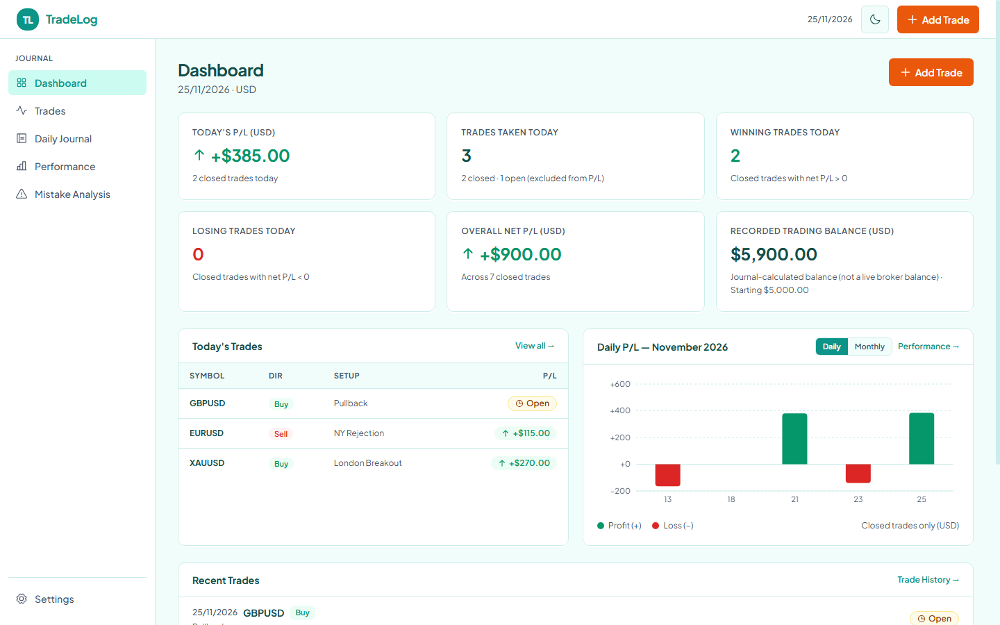
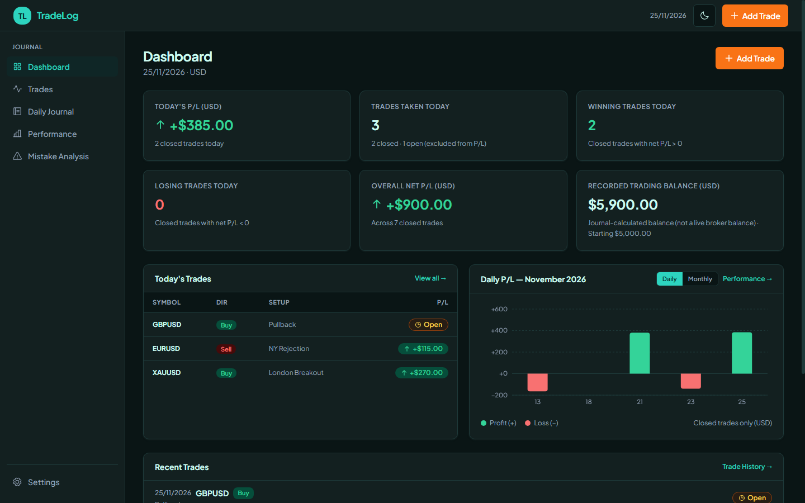
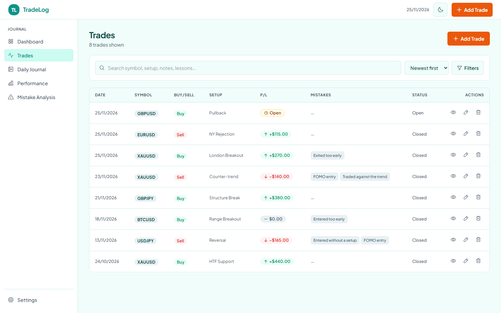
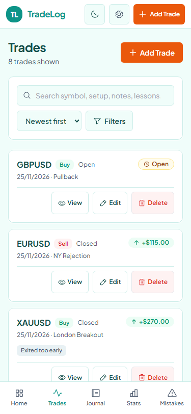
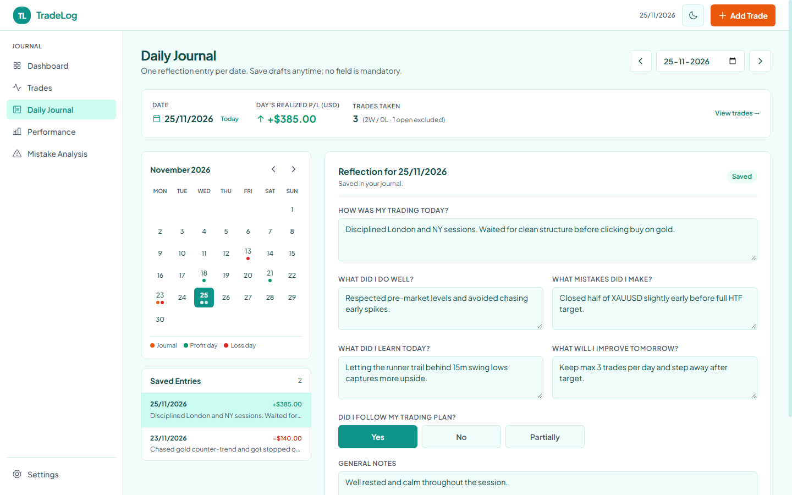
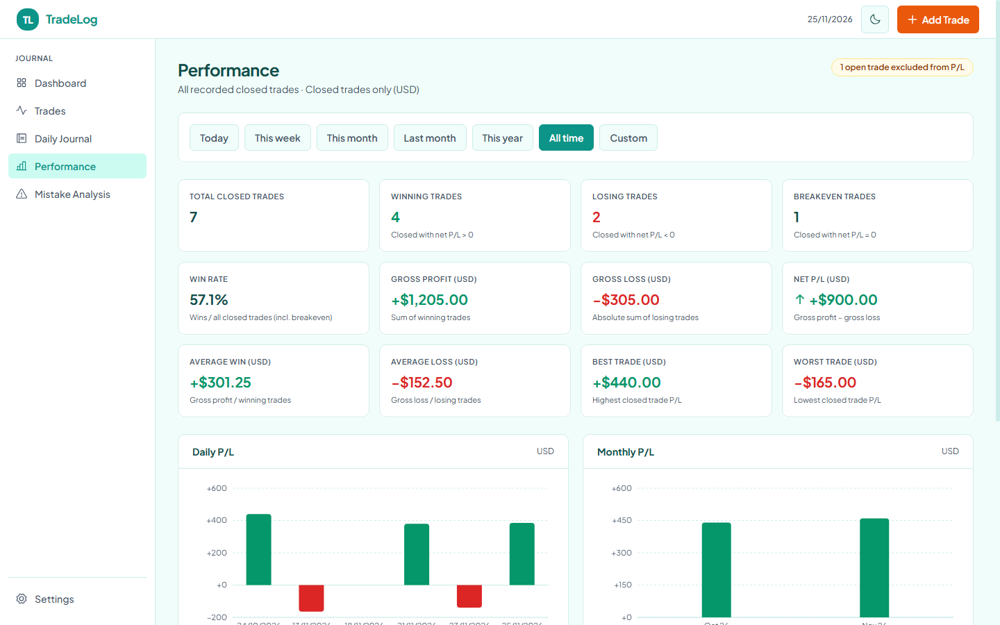
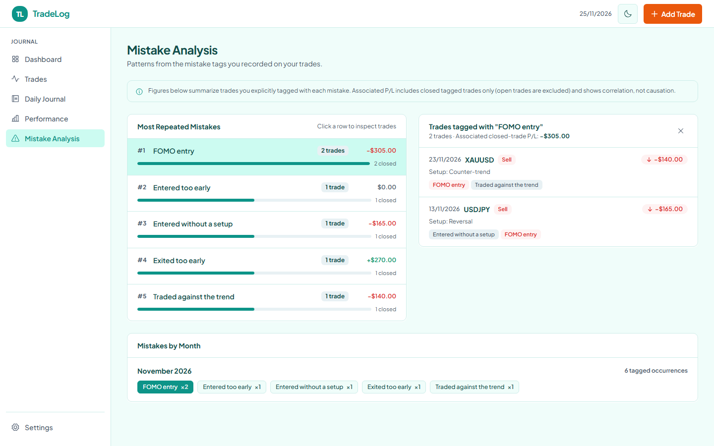

# TradeLog — Personal Trading Journal

A clean, lightweight **personal trading journal web application** for recording trades, daily profit/loss, trading mistakes, emotions, and lessons learned. Built as a calm digital diary for self-review—not a trading terminal or broker platform.

---

## Screenshots

### Dashboard (Light & Dark Themes)
| Light Mode | Dark Mode |
| :---: | :---: |
|  |  |

### Trade History & Mobile Responsive View
| Desktop Trade Table | Mobile Trade Cards (`375px`) |
| :---: | :---: |
|  |  |

### Daily Journal, Performance & Mistake Analysis
| Daily Journal | Performance | Mistake Analysis |
| :---: | :---: | :---: |
|  |  |  |

---

## Core Features

1. **Dashboard**
   - Summary cards: Today's P/L, Trades Taken Today, Winning Trades Today, Losing Trades Today, Overall Net P/L, and optional journal-calculated Recorded Trading Balance.
   - Today's trades list, Recent Trades (last 5), Daily/Monthly P/L bar chart, quick **Add Trade** action, and a reminder banner when today's daily journal is incomplete.
   - Open trades are always excluded from realized P/L totals.
2. **Trades (`/trades`)**
   - Fast Add / Edit trade form with pre-populated common instruments (`XAUUSD`, `EURUSD`, `GBPUSD`, `USDJPY`, `GBPJPY`, `BTCUSD`, indices, oil) plus custom symbol support.
   - Manual signed P/L entry (`+` profit, `−` loss, `0` breakeven).
   - Journaling fields: Setup, Entry Reason, Exit Reason, Multi-select Mistakes (+ custom mistake), Emotion, Followed Plan (`Yes` / `No` / `Partially`), Lesson Learned, and multi-image chart screenshot uploads.
   - Search by symbol or notes, filter by date range/symbol/direction/outcome/mistake/status, sort by date or P/L, responsive mobile trade cards, detail lightbox, and delete confirmation.
3. **Daily Journal (`/journal`)**
   - One reflection entry per date (enforced at DB & API level) with all 7 reflection fields + plan-followed selector.
   - Automatically displays that day's realized P/L and trade count at the top.
   - Interactive month calendar + saved entries list, incomplete draft saving, and local unsaved-draft backup.
4. **Performance (`/performance`)**
   - Closed-trade metrics: Total Closed Trades, Wins, Losses, Breakeven, Win Rate (`wins / all closed × 100`), Gross Profit, Gross Loss, Net P/L, Average Win, Average Loss, Best Trade, and Worst Trade (`---` on zero denominators).
   - Time filters: Today, This Week, This Month, Last Month, This Year, All Time, and Custom Date Range.
   - Daily P/L bar chart, Monthly P/L bar chart, Cumulative P/L line chart, and mixed-currency safeguards.
5. **Mistake Analysis (`/mistakes`)**
   - Neutral frequency ranking of tagged mistakes, monthly breakdown, associated closed-trade P/L, and click-to-inspect drill-down showing all trades tagged with each mistake.
6. **Settings, Export & Backup (`/settings`)**
   - Preferred currency, optional starting balance, Light/Dark theme persistence, and custom instruments / custom mistakes management.
   - **CSV Export** of all trades (`YYYY-MM-DD` dates, signed P/L, mistakes, screenshot references, RFC-4180 escaping).
   - **Full JSON Backup & Transactional Restore** with schema validation, new-vs-duplicate preview, explicit confirmation dialog, **Safe Merge** (skip duplicates) or **Update Duplicates**, and SQLite rollback on error.

---

## Tech Stack

- **Frontend:** React 18, Vite 6, TypeScript, Tailwind CSS v3, TanStack React Query, Zustand, Recharts, Phosphor Icons
- **Backend:** Node.js, Express.js, Multer
- **Database:** SQLite via Node.js built-in `node:sqlite` (`DatabaseSync`, WAL mode)
- **Package Manager:** pnpm (workspaces)

---

## Prerequisites

- **Node.js 22.5+** (tested on Node.js `v24.22.1`)
- **pnpm** (`npm install -g pnpm`)

---

## Running the Application

### Production Server (Recommended for Daily Use)

```powershell
cd trade-journal

# 1. Install dependencies (first time only)
pnpm install

# 2. Build the frontend (already built; re-run only after frontend edits)
pnpm build

# 3. Start the server
pnpm start
```

Open **http://localhost:3001/** in your browser.  
Health check: `http://localhost:3001/api/health`

### Development Mode (Frontend HMR + API Watch)

```powershell
pnpm dev
```

- Frontend (Vite dev): `http://localhost:5173/`
- Backend API: `http://localhost:3001/`

---

## Running Verification Tests

All phase verification scripts run against isolated temporary SQLite databases and upload directories without touching your personal `journal.db`:

```powershell
pnpm --filter client build
node server/test-phase2.js   # Trade CRUD, filters, validation, multi-screenshot upload/delete
node server/test-phase3.js   # Dashboard metrics, open-trade exclusion, edit/delete recalculation
node server/test-phase4.js   # Daily journal CRUD, duplicate prevention, restart persistence
node server/test-phase5.js   # Performance stats, time filters, mistake frequency & drill-down
node server/test-phase6.js   # Settings persistence, CSV/JSON export, preview & rollback restore
```

---

## Data Storage & Privacy

- **Database:** `journal.db` (SQLite, local to the project root)
- **Screenshots:** `uploads/<tradeId>/`
- Both `journal.db*` and `uploads/` are listed in `.gitignore` so personal records stay on your machine.
- Use **Settings → Download Backup JSON** regularly to keep an external copy of your trades, journal entries, and settings.

---

## Project Structure

```text
trade-journal/
├── client/                  # React + Vite + TypeScript frontend
│   └── src/
│       ├── components/      # Layout, ThemeProvider, TradeForm, TradeDetail, PnlBadge, ConfirmDialog
│       ├── hooks/           # React Query hooks (useTrades, useJournal)
│       ├── lib/             # API wrapper, constants, date/currency/analytics utils
│       └── pages/           # Dashboard, Trades, Journal, Performance, Mistakes, Settings
├── server/                  # Express backend & SQLite data layer
│   ├── db/                  # schema.sql, database.js, migrate.js
│   ├── middleware/          # Multer image upload validation & storage
│   ├── routes/              # trades.js, journal.js, settings.js, export.js
│   └── test-phase*.js       # End-to-end integration test suites
├── docs/screenshots/        # Screenshots used in this README
├── dist/client/             # Built frontend served by `pnpm start`
├── uploads/                 # Trade screenshot storage (gitignored)
├── journal.db               # SQLite database (created on first run, gitignored)
└── .env.example             # Optional PORT, CLIENT_URL, DB_PATH, UPLOADS_DIR overrides
```

---

## Environment Configuration

Copy `.env.example` to `.env` only if you want to override defaults:

```env
PORT=3001
CLIENT_URL=http://localhost:5173
DB_PATH=./journal.db
UPLOADS_DIR=./uploads
```
